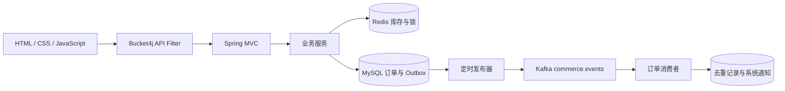

# ShopVerse 技术与架构报告

## 定位与边界

本项目是用于学习和简历展示的模块化单体电商应用，重点演示订单持久化、库存竞争、消息异步投递及接口限流。界面采用简洁深灰、深蓝和白色风格，商品、客服、支付和物流包含演示设定，不是可直接上线的交易平台。

## 架构

Java 25、Spring Boot 3.5.0、JPA/Hibernate、HikariCP 构成后端；开发默认 H2，Docker 使用 MySQL 8.4、Redis 7.4、Kafka 3.9.0。Bucket4j 8.11.0 由 Spring Filter 接入。前端静态资源由应用托管，不依赖独立前端构建工具。

## 下单与库存

直接购买提交当前商品，购物车结算提交勾选项；服务端计算价格与优惠，保存商品快照、数量、总额、购买渠道、付款方式、地址及订单状态。

Redis 协调器按商品 ID 排序获取带令牌的短租约锁，逐商品执行 Lua 检查与扣减，失败时补偿已扣减项。锁仅覆盖库存预留阶段，在数据库提交前已经释放；不能实现请求幂等，也不能保证 Redis 与 SQL 跨系统原子性。订单创建过程中的部分异常会释放库存，但进程崩溃或事务代理提交失败的窗口仍是风险。库存缓存缺失时从配置恢复，不能替代持久化库存账本。

## Kafka 消费闭环

订单与 Outbox 在 SQL 本地事务内写入。发布器轮询待发送事件，等待 Kafka 确认，成功后标记 PUBLISHED，失败退避重试。消息包含 eventId、type、payload；发布确认与状态落库间故障可能造成重复发送，因此语义为至少一次。

消费者组 `shopverse-order-notifications-v1` 监听 `commerce.events`，处理 ORDER_CREATED，在同一数据库事务写入 consumed_events 与 chat_messages。事件主键用于去重，事务成功返回后确认记录；历史无 eventId 的事件使用订单号构成稳定键。其他事件类型忽略。失败无限重试，当前无 DLQ，坏消息可能阻塞分区。

消费落库已验证，但消息 UI 不支持 system 会话，用户可见闭环尚不完整，属于待修复缺陷。

## 限流语义

`/api` 与 `/api/**` 共用单实例容量 100 的令牌桶，每秒整体补充 100。超限返回 HTTP 429、RATE_LIMITED JSON 和 Retry-After。静态资源及健康检查不消耗令牌。周期边界可能产生突发；多实例各自拥有额度，未来需要共享桶或统一网关。该措施保护应用吞吐，不代替认证、用户级配额或网络防护。

## 主要接口

| 方法 | 路径 | 功能 |
|---|---|---|
| GET | /api/home | 推荐、分类、活动 |
| GET | /api/products | query/category 搜索筛选 |
| GET | /api/products/{id} | 详情、规格和库存 |
| GET | /api/cart | 购物车 |
| POST | /api/cart/items | 加入商品 |
| PUT / DELETE | /api/cart/items/{id} | 修改或删除 |
| PUT | /api/cart/selection | 全选/取消 |
| POST | /api/cart/checkout | 合并结算 |
| POST | /api/orders/direct | 直接购买 |
| GET / PUT | /api/account | 个人资料、地址、收藏 |
| GET | /api/account/orders | 订单列表 |
| GET | /api/conversations | 会话列表 |
| GET / POST | /api/conversations/{id}/messages | 会话收发 |
| GET / POST | /api/messages | 消息列表及发送 |
| GET | /api/profile | 演示个人概览 |

请求示例：`POST /api/orders/direct`，JSON 包含 productId、variant、quantity、couponCode、paymentMethod、receiverName、receiverPhone、receiverAddress。成功返回 201；非法输入/库存错误通常为 400，限流为 429。当前不是完整统一业务错误码体系。

## 测试证据与限制

2026-11-10：Docker 未限流基线 800 请求成功落库 600 件、剩余 0，成功请求平均 109.70 ms、P95 467 ms。限流开启后隔离环境 800 请求中 522 次 201、278 次 429，SQL 购买件数 522、Redis 剩余 78，成功请求平均 44.21 ms、P95 121 ms、P99 164 ms。两次配置和初始状态不同，不可直接作为优化收益对比。

功能接口 42 项状态码检查有 1 项失败：系统通知会话返回 400。浏览器检查确认四个主要页面可打开，发现商品详情未显示直接购买入口。Maven 2 项测试通过。Kafka 重复投递验证未增加重复通知。

PowerShell 30 秒读负载发生本机套接字端口耗尽，不能据此归因服务器故障或给出容量。后续 JMeter 持续负载被用户停止，未完成最终验收。故障注入操作被执行策略阻止。所有结果属于同机、单应用验证，尚无独立压测机、多实例、长时稳定性或完整安全测试结论。

## 改进优先级

1. 修复 system 通知入口和商品直接购买前端入口，增加浏览器端回归测试。
2. 建立持久化库存账本、请求幂等键和事务完成补偿，测试崩溃与重启恢复。
3. 消费重试上限、DLQ、积压告警、事件重放；监控锁等待、库存拒绝和发送延迟。
4. JWT、密码加密、RBAC、按用户隔离购物车/订单，以及分布式限流。
5. order_items 规范化、分页、查询索引、真实配置定价及输入验证。
6. 独立压测机、持续负载、多实例和故障注入验证；之后再评估 CDC、链路追踪和第三方支付物流。

面试可围绕“SQL 本地事务 + Redis 原子扣减 + Outbox 至少一次投递 + 消费幂等”展开，同时明确跨系统事务边界，避免声称 exactly-once、生产高可用或绝对不超卖。
